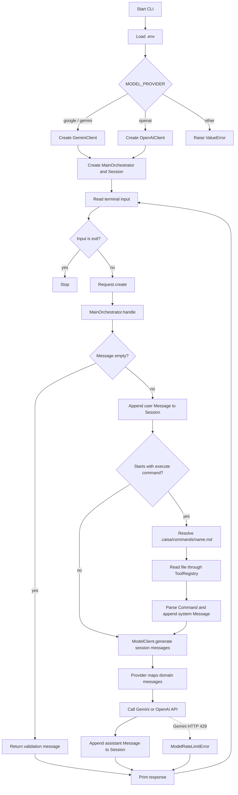
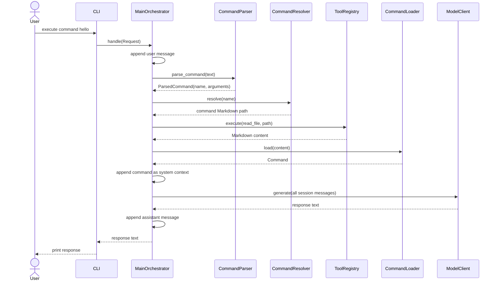

# Project structure

Current repository layout. Generated and local-only artifacts (`.git`, `.venv`,
`.env`, `__pycache__`, and `*.egg-info`) are omitted.

```text
caisa_harnes_project/
├── .caisa/
│   ├── CAISA.md
│   └── commands/{hello.md,test_write_file.md}
├── .env.example
├── .gitignore
├── README.md
├── config/
│   ├── agents/AGENTS.md
│   ├── harness/HARNESS.md
│   ├── rules/RULES.md
│   ├── tools/TOOLS.md
│   └── workflows/WORKFLOWS.md
├── data/{cache,logs,memory}/
├── doc/project_strucrure.md
├── main.py
├── prompts/{agents,system,workflows}/
├── pyproject.toml
├── scripts/
├── src/harness/
│   ├── app/
│   │   └── cli/
│   │       ├── main.py
│   │       └── reader.py
│   ├── builder/
│   │   ├── model_message_builder.py
│   │   └── tool_parameters_builder.py
│   ├── contracts/
│   │   └── tool.py
│   ├── domain/
│   │   ├── command.py
│   │   ├── message.py
│   │   ├── session.py
│   │   ├── tool_call.py
│   │   └── tool_result.py
│   ├── factory/
│   │   └── model_client_factory.py
│   ├── loader/
│   │   └── command_loader.py
│   ├── mappers/
│   │   ├── google_mapper.py
│   │   └── openai_mapper.py
│   ├── models/
│   │   ├── errors.py
│   │   ├── model_client.py
│   │   ├── request.py
│   │   ├── response.py
│   │   ├── response_instruction.py
│   │   └── tool_result_summary.py
│   ├── parser/
│   │   ├── command_parser.py
│   │   ├── parse_tool_calls.py
│   │   └── response_parser.py
│   ├── providers/
│   │   ├── anthropic_client.py
│   │   ├── google_client.py
│   │   └── openai_client.py
│   ├── resolver/
│   │   └── command_resolver.py
│   ├── tools/
│   │   ├── bash_tool.py
│   │   ├── read_file_tool.py
│   │   ├── register_tools.py
│   │   ├── tool_registry.py
│   │   └── write_file_tool.py
│   ├── agents/main_orchestrator.py
│   └── session_manager.py
└── tests/
    ├── evals/
    ├── integration/
    ├── unit/{__init__.py,test_cli_main.py}
    └── __init__.py
```

## Main responsibilities

- `app` owns the CLI, application models and model contracts, command services, active domain models, tool registration, runner, and session manager.
- `application` contains remaining orchestration scaffolding.
- `domain` contains remaining role, session-state, and task scaffolding.
- `providers` contains the Gemini and OpenAI clients and an empty Anthropic client placeholder.
- `mappers` contains separate Google and OpenAI message mappings.
- `execution` contains executable tools and workflow steps.
- `infrastructure` contains persistence, observability, and security adapters.
- `tests` separates unit, integration, and evaluation coverage.

## Current implementation summary

The project currently implements a small, stateful command-line AI harness. A
single `MainOrchestrator` keeps the conversation in memory, optionally loads a Markdown
command from `.caisa/commands/`, and sends the accumulated messages to Gemini
or OpenAI. Most of the larger architecture shown above is scaffolding: many
agent, workflow, API, infrastructure, and tool modules are currently empty.

### Implemented objects and responsibilities

| Object or function | Location | Responsibility and current logic |
|---|---|---|
| `Request` | `app/models/request.py` | Immutable application input containing the user's message and a UTC creation timestamp. `Request.create()` supplies the timestamp. |
| `MainOrchestrator` | `harness/agents/main_orchestrator.py` | Central application orchestrator. Owns one in-memory `Session`, command services, and a tool registry. Validates input, stores messages, loads optional command context, calls the selected model, and stores the response. |
| `ParsedCommand` / `parse_command()` | `app/parser/command_parser.py` | Recognizes input beginning with `execute command` (case-insensitive), separates the command name and arguments, and rejects a missing command name. Arguments are parsed but are not used by `MainOrchestrator` yet. |
| `CommandResolver` | `app/resolver/command_resolver.py` | Maps a command name to `.caisa/commands/<name>.md` and rejects unknown commands. |
| `CommandLoader` | `app/loader/command_loader.py` | Parses Markdown sections headed by `# `. Requires `Name` and `Description`; stores every other section in `Command.sections`. |
| `Command` | `app/domain/command.py` | Immutable command definition: name, description, and additional Markdown sections. |
| `Message` | `app/domain/message.py` | Immutable conversation message. Its role is restricted to `user`, `assistant`, or `system`. |
| `Session` | `app/domain/session.py` | Mutable in-memory conversation with a generated UUID and ordered messages. It is created once per `MainOrchestrator`; there is no persistence or reset behavior yet. |
| `ToolCall` | `app/domain/tool_call.py` | Immutable name-and-arguments representation for a future model-requested tool call. It is not connected to the model loop yet. |
| `ModelClient` | `app/models/model_client.py` | Provider-neutral protocol requiring `generate(messages) -> str`. This is the boundary used by `MainOrchestrator`. |
| `create_model_client()` | `factory/model_client_factory.py` | Selects Gemini for `google`/`gemini` (the default) or OpenAI for `openai`, using `MODEL_PROVIDER`. Other values fail immediately. |
| `GeminiClient` | `providers/google_client.py` | Reads `GEMINI_API_KEY` and optional `GEMINI_MODEL`, maps messages to the Google SDK, calls `generate_content`, and converts HTTP 429 errors into `ModelRateLimitError`. |
| Google `map_messages()` | `mappers/google_mapper.py` | Converts assistant messages to Gemini's `model` role, keeps user messages as `user`, and combines all system messages into one system instruction. |
| `OpenAIClient` | `providers/openai_client.py` | Uses the OpenAI Responses API and optional `OPENAI_MODEL`, maps the session messages, and returns `response.output_text`. |
| OpenAI `map_messages()` | `mappers/openai_mapper.py` | Converts domain messages into dictionaries containing `role` and `content`. |
| `ModelRateLimitError` | `app/models/errors.py` | Provider-neutral error currently used for Gemini quota/rate-limit failures and handled by the packaged CLI. |
| `Tool` | `contracts/tool.py` | Protocol for named tools with a description and `execute(arguments) -> str`. |
| `ToolRegistry` | `app/tools/tool_registry.py` | Registers unique tools, resolves tools by name, executes them, and lists registered instances. |
| `register_tools()` | `app/tools/register_tools.py` | Registers `ReadFileTool` and `WriteFileTool` in each `MainOrchestrator`. |
| `ReadFileTool` | `tools/read_file_tool.py` | Validates a string path, requires an existing file, and returns its UTF-8 text. The runner uses it internally to load command files. |
| `WriteFileTool` | `tools/write_file_tool.py` | Validates path/content strings, creates parent directories, writes UTF-8 text, and returns a success message. It is registered but cannot currently be invoked by a model response. |
| `read_input()` | `app/cli/reader.py` | Reads and trims one terminal message. EOF or Ctrl+C is converted into `exit`. |
| CLI `main()` | `app/cli/main.py` | Loads `.env`, creates the selected model and runner, runs the prompt loop, stops on `exit`, and reports model rate-limit errors without ending the process. |

## Runtime workflow schema



### Command execution sequence



## State and data flow

1. The CLI converts raw terminal text into a timestamped `Request`.
2. `MainOrchestrator` converts the request into a domain `Message` and appends it to its
   long-lived `Session`.
3. Normal messages go directly to the model. Command messages first add a
   generated `system` message based on the selected Markdown command.
4. The provider mapper converts domain messages into SDK-specific input.
5. The provider response is stored as an `assistant` message, making it part of
   the next request's context.
6. All session state is process-local and is lost when the CLI exits.

## Implemented versus planned

### Working now

- Interactive CLI conversation loop.
- In-memory multi-turn conversation history.
- Gemini and OpenAI provider selection.
- Markdown command detection, resolution, loading, and prompt injection.
- Internal read/write filesystem tools and a reusable registry.
- Friendly Gemini quota error handling in the packaged CLI.

### Scaffolded but not implemented

- Agent types (`coding`, `review`, `testing`, `debugging`, and `architect`).
- Context building, retrieval, compression, token counting, and window control.
- Feature, debugging, and code-review workflow steps.
- Shell, Git, testing, search, and edit tools.
- Memory persistence, project/session storage, logs, metrics, and tracing.
- Approval and permission enforcement.
- Anthropic and local model providers.
- Task/session state models beyond the implemented in-memory `Session`.
- Integration and evaluation tests.

## Important current limitations

- The model can only return text. `ToolCall` is not parsed or executed, so a
  command that asks the model to use `write_file` cannot actually trigger it.
- `.caisa/CAISA.md` is not loaded into the session even though a loader exists.
- Parsed command arguments are discarded by `MainOrchestrator`.
- Command names are used to construct filesystem paths without explicit
  project-root containment validation.
- Read/write tools accept unrestricted paths; the security scaffolding is empty.
- Provider calls are synchronous and have no retry, timeout, streaming, or
  general provider-error translation.
- `pyproject.toml` declares only `openai`, while the implemented CLI also imports
  `python-dotenv` and the Google Gen AI SDK.
